<div align="center">

# RISC-V RV32I 3-Stage Pipelined Processor on Zynq-7000 (ZC702)

### A custom, fully synthesizable 3-stage pipelined RISC-V (RV32I) core with Machine-Mode CSRs and a BRAM-backed on-chip hardware trace logger


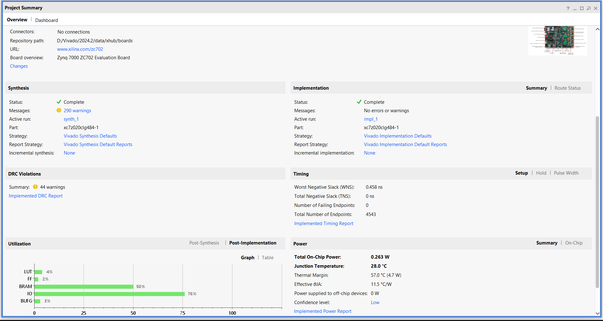

</div>

---

## 📑 Table of Contents

1. [Project Overview](#1-project-overview)
2. [Key Features at a Glance](#2-key-features-at-a-glance)
3. [Design Philosophy & Architectural Motivation](#3-design-philosophy--architectural-motivation)
4. [Top-Level Architecture](#4-top-level-architecture)
5. [Pipeline Stage Breakdown](#5-pipeline-stage-breakdown)
6. [Detailed Architectural Summary of Every Hardware Block](#6-detailed-architectural-summary-of-every-hardware-block)
7. [Supported Instruction Set](#7-supported-instruction-set)
8. [Assembly Program & Execution Flow](#8-assembly-program--execution-flow)
9. [Simulation Results](#9-simulation-results)
10. [Hardware Execution Trace Verification](#10-hardware-execution-trace-verification)
11. [Synthesis, Implementation & Resource Utilization](#11-synthesis-implementation--resource-utilization)
12. [Timing Closure & Performance Analysis](#12-timing-closure--performance-analysis)
13. [Power & Thermal Analysis](#13-power--thermal-analysis)
14. [Placement & Routing](#14-placement--routing)
15. [Bitstream Generation & Hardware Handoff (.xsa)](#15-bitstream-generation--hardware-handoff-xsa)
16. [Repository Structure](#16-repository-structure)
17. [Getting Started](#17-getting-started)
18. [Complete Image Gallery](#18-complete-image-gallery)
19. [Future Work](#19-future-work)
20. [Author & Contact](#20-author--contact)
21. [License](#21-license)

---

## 1. Project Overview

This project realizes a **custom, highly optimized, and fully synthesizable 3-stage pipelined RISC-V processor core** built around the standard **RV32I base integer instruction set architecture (ISA)**, complemented by a complete **Machine-Mode Control and Status Register (CSR)** subsystem.

Architected for high-efficiency embedded processing, the design targets the **Xilinx Zynq-7000 ZC702 Evaluation Board (`xc7z020clg484-1`)**. By tailoring the microarchitecture to FPGA-specific primitives such as Configurable Logic Blocks (CLBs), dedicated routing matrix resources and embedded Block RAMs (BRAMs), the processor achieves a balance between execution throughput, minimal logic footprint and hardware reliability.

The entire flow has been taken from **RTL coding → simulation → synthesis → place-and-route → timing closure → bitstream generation → `.xsa` hardware handoff** using **Xilinx Vivado 2024.2**.

### 📸 Stage-Wise Block Diagram

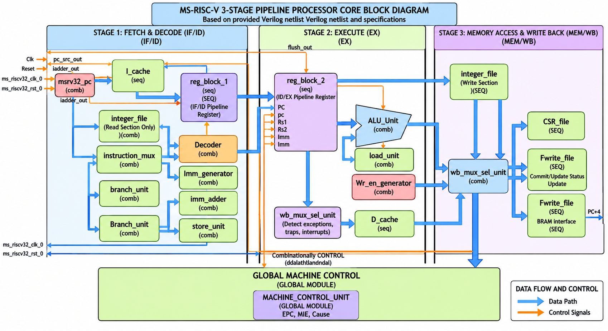

---

## 2. Key Features at a Glance

| Category | Details |
|---|---|
| **ISA** | RISC-V RV32I base integer ISA + Machine-Mode CSRs |
| **Pipeline** | 3 stages: Fetch/Decode → Execute → Memory/Writeback |
| **Hazard Handling** | `flush_in` driven NOP injection (`32'h0000_0013`) + flush-protected write enables |
| **Memory Subsystem** | Inferred Block RAM data cache (`D_cache`, 256 KB) with byte-masked writes |
| **Load/Store** | `LB`, `LBU`, `LH`, `LHU`, `LW`, `SB`, `SH`, `SW` with full alignment/extension logic |
| **Exceptions** | Illegal instruction, misaligned load, misaligned store detection |
| **CSR Support** | `mstatus`, `misa`, `mie`, `mip`, `mtvec`, `mepc`, `mtval`, `mcause`, `mscratch`, `mcycle`, `minstret`, `mtime`, `mcountinhibit` |
| **Debug** | Synthesizable BRAM trace logger (`fwrite_file`) with 172-bit records and a 140-bit `result_status` bus |
| **Target Board** | Zynq-7000 ZC702 (`xc7z020clg484-1`) |
| **Toolchain** | Xilinx Vivado 2024.2 |
| **LUT Utilization** | 4% |
| **FF Utilization** | 2% |
| **BRAM Utilization** | 50% |
| **Power** | 0.263 W total on-chip |
| **Timing** | WNS +0.458 ns, TNS 0.000 ns, 0 failing endpoints |

---

## 3. Design Philosophy & Architectural Motivation

The 3-stage pipeline topology is chosen deliberately to **streamline control hazards, minimize pipeline-register overhead and maximize clock frequency** in low-to-mid-range FPGA fabrics.

- Deeply pipelined cores suffer severe branch-penalty overhead unless complex branch predictors are added.
- Single-cycle processors are constrained by long combinational delay paths.

The 3-stage approach cleanly partitions instruction execution across:

1. **Instruction Fetch & Decode Stage**: instruction ingestion, control signal generation, immediate extraction.
2. **Execution & Address Calculation Stage**: ALU operations, branch/jump evaluation, effective memory address generation.
3. **Memory Access, Writeback & Logging Stage**: data cache interaction, load alignment, register file writeback, CSR management and on-chip trace logging.

### Key Architectural Pillars

- **Custom Pipeline Control & Hazard Mitigation**: Control signals such as `flush_in` dynamically inject safe NOP instructions (`32'h0000_0013`, i.e. `addi x0, x0, 0`) during control hazards, exceptions or traps, preventing illegal or speculative instructions from mutating architectural state or data memory.
- **Granular Memory Subsystem (`D_cache` & Load/Store Units)**: Inferred Block RAM structures implement the memory hierarchy. Byte-masked writes (`SB`, `SH`, `SW`) and flexible signed/unsigned loads (`LB`, `LBU`, `LH`, `LHU`, `LW`) are natively supported.
- **Synthesizable Debug & Trace Logging (`fwrite_file`)**: Non-synthesizable simulation print statements (`$display` / `$fwrite` file I/O) are replaced with a hardware-synthesizable, BRAM-backed logging unit. Program counters, destination register updates, memory addresses and payloads are packed into structured **172-bit records** stored in an on-chip dual-port BRAM (`blk_mem_gen_0`) and exposed through a **140-bit `result_status` bus** for real-time, cycle-accurate trace extraction.
- **Complete Toolchain & Implementation Integration**: RTL coding, synthesis, place-and-route, timing closure, bitstream generation and `.xsa` handoff were all verified in Vivado.

---

## 4. Top-Level Architecture

### 4.1 Core Wrapper Block Diagrams

The core is packaged as a wrapper that exposes the instruction memory interface, data memory (AHB-style) interface, interrupt inputs, clock/reset and the trace/status output bus.

| Block Diagram 1 | Block Diagram 2 |
|:---:|:---:|
| 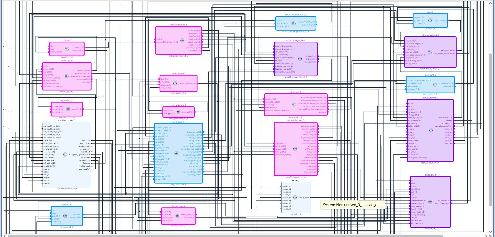 | 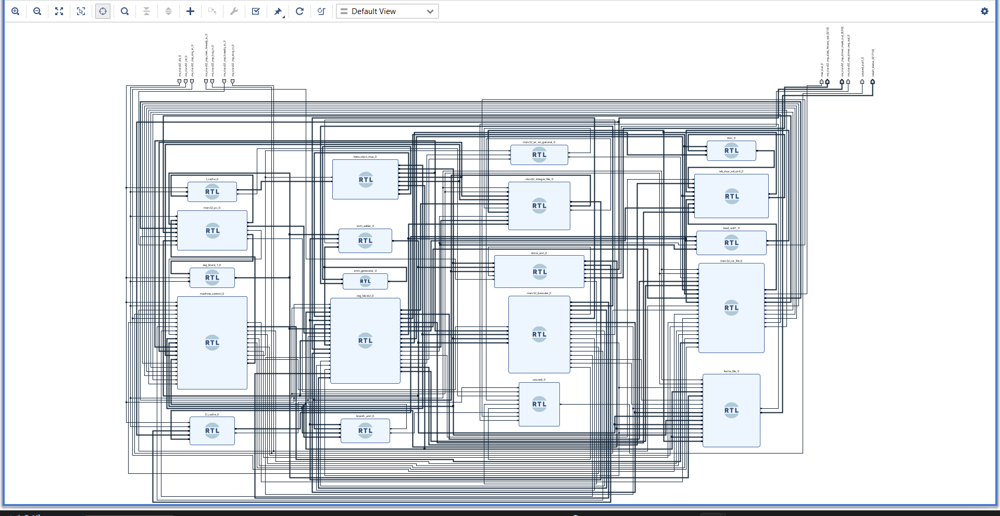 |

### 4.2 Post-Implementation Block Diagrams

These are the corresponding block diagrams captured after implementation in Vivado.

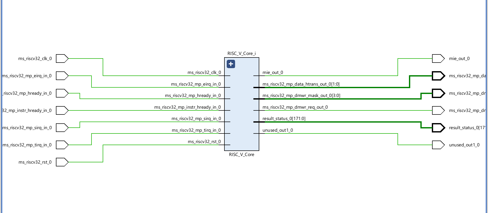

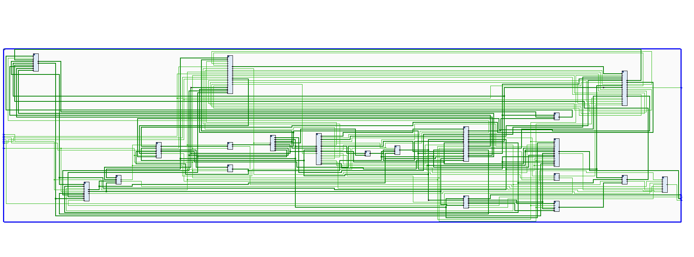

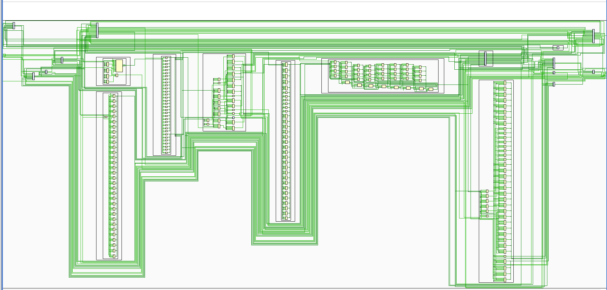

### 4.3 Conceptual Pipeline View

```
 ┌─────────────────────────┐   ┌──────────────────────────────┐   ┌──────────────────────────────────┐
 │  STAGE 1                │   │  STAGE 2                     │   │  STAGE 3                         │
 │  Fetch & Decode         │   │  Execute & Address Calc      │   │  Memory, Writeback & Logging     │
 │                         │   │                              │   │                                  │
 │  • PC / Next-PC Mux     │   │  • imm_adder                 │   │  • D_cache (BRAM)                │
 │  • instruction_mux      │──▶│  • branch_unit               │──▶│  • load_unit1                    │
 │  • msrv32_decoder       │ ▲ │  • ALU                       │   │  • wb_mux_sel_unit               │
 │  • imm_generator        │ │ │  • store_unit                │   │  • msrv32_wr_en_generator        │
 │  • Integer Register File│ │ │                              │   │  • msrv32_csr_file               │
 │  • Machine Control Unit │ │ │                              │   │  • fwrite_file (trace logger)    │
 └─────────────────────────┘ │ └──────────────────────────────┘   └──────────────────────────────────┘
                             │            ▲
                  reg_block2 (ID/EX pipeline register)
        branch_taken / flush_in ◀──────────┘  (steers PC mux & injects NOP)
```

---

## 5. Pipeline Stage Breakdown

### Stage 1: Instruction Fetch, Decode & Immediate Generation

The entry point of the pipeline. It ingests raw instruction words, sanitizes them against hazards, decodes them into datapath control vectors, extracts and extends immediates, and reads the integer register file.

**Modules:** `instruction_mux`, `msrv32_decoder`, `imm_generator`, program counter block, integer register file, `reg_block1`, Machine Control Unit.

### Stage 2: Execution, Address Calculation & Branch Evaluation

**Modules:** `reg_block2`, `imm_adder`, `branch_unit`, `ALU`, `store_unit`

Acting as the central computational and execution engine, Stage 2 processes latched control and data payloads, resolves control-flow decisions, computes memory effective addresses, and performs arithmetic and logical transformations.

- **ID/EX Pipeline Synchronization (`reg_block2`)**: Functions as the intermediate pipeline buffer register, clocked on the positive edge of `ms_riscv32_mp_clk_in` with an active-high reset (`ms_riscv32_mp_rst_in`). It holds register read data (`rs1`, `rs2`), program counters (`pc`, `pc + 4`), address offsets, immediate values and control signals stable across clock boundaries, preventing race conditions. It also incorporates **branch target alignment logic** that forces the LSB of the jump/branch address register (`imm_iadder_reg2_out[0]`) to `0` when a branch is taken.
- **Effective Address & Target Calculation (`imm_adder`)**: Computes branch/jump targets and base-plus-offset memory addresses. Using the decoder's `iadder_src_in`, it multiplexes between the PC (`pc_in`, for PC-relative branches and `jal`) and source register 1 (`rs1_in`, for `jalr` and load/store base addresses), adding the selection to the extended immediate (`imm_in`).
- **Branch and Jump Resolution (`branch_unit`)**: Evaluates branch and jump conditions to assert `branch_taken_out`. For `BEQ`, `BNE`, `BLT`, `BGE`, `BLTU`, `BGEU` it performs signed and unsigned magnitude comparisons between `rs1_in` and `rs2_in`. For `JAL` and `JALR` it forces the branch signal high.
- **Arithmetic & Logic Processing (`ALU`)**: Executes parallel operations on 32-bit operands (`op_1_in`, `op_2_in`) based on `opcode_in`: add, subtract, `SLT`, `SLTU`, `AND`, `OR`, `XOR`, `SLL`, `SRL`, `SRA`, with the right result routed through an output multiplexer.
- **Store Data Alignment & Masking (`store_unit`)**: Prepares data for `SB`, `SH`, `SW`. Shifts bytes/half-words from `rs2_in` into the correct byte lane (based on `imm_iaddr_in[1:0]`), word-aligns the store address, generates 4-bit byte-write enable masks (`ms_riscv32_mp_dmwr_mask_out`) and drives AHB transfer control (`ms_riscv32_mp_data_htrans_out`).

### Stage 3: Writeback, Memory Access & Trace Logging

**Modules:** `wb_mux_sel_unit`, `load_unit1`, `D_cache`, `fwrite_file`, `msrv32_csr_file` (plus `msrv32_wr_en_generator`)

The final stage finalizes instruction execution, interacts with data memory, handles register writebacks, manages machine-mode system registers and records hardware execution traces.

- **Data Memory Interaction & Load Processing (`D_cache` & `load_unit1`)**: `D_cache` provides inferred Block RAM storage with continuous synchronous reads and conditional byte-masked writes. `load_unit1` receives the raw 32-bit read word (`ms_riscv32_mp_dmdata_in`), extracts the addressed byte/half-word/word using `imm_iaddr_in[1:0]` and performs sign- or zero-extension (`LB`, `LBU`, `LH`, `LHU`, `LW`).
- **Writeback Routing & Control Gating (`wb_mux_sel_unit` & `msrv32_wr_en_generator`)**: `wb_mux_sel_unit` selects the ALU's second operand and multiplexes the final value written back to the integer register file (`wb_mux_out`) from ALU results, load data, `LUI` immediates, `AUIPC` adder outputs, CSR data, or return addresses (`PC + 4` for `JAL`/`JALR`). `msrv32_wr_en_generator` produces gated, safe write-enables so a `flush_in` immediately inhibits writes.
- **Synthesizable On-Chip Trace Logging (`fwrite_file`)**: Captures execution history on hardware by packing PCs, writeback payloads and memory transaction metrics into 172-bit records stored in a dual-port BRAM (`blk_mem_gen_0`), and exposes a 140-bit `result_status` bus to FPGA pins.
- **Control and Status Registers (`msrv32_csr_file`)**: Implements the complete RISC-V Machine-Mode privilege architecture: `mstatus`, `misa`, `mie`, `mip`, `mtvec`, `mepc`, `mtval`, `mcause`, `mscratch` and the 64-bit counters `mcycle`, `minstret`, `mtime`, together with `mcountinhibit`.

---

## 6. Detailed Architectural Summary of Every Hardware Block

This section gives an in-depth technical breakdown of every functional hardware block across the 3-stage pipelined RISC-V (RV32I) core, covering microarchitecture, data/control path interactions and FPGA synthesis considerations.

---

### 6.1 Instruction Fetch & Alignment Multiplexer (`instruction_mux`)

**Primary Role:** Entry point for instruction ingestion and pipeline hazard sanitization.


**Microarchitectural Details**

- Ingests raw 32-bit instruction words from instruction memory (`ms_riscv32_mp_instr_in`).
- Implements a hazard gate controlled by `flush_in`. Whenever a pipeline flush occurs (branch mispredictions, jumps, or synchronous/asynchronous traps), it overrides the incoming instruction stream and injects a canonical RISC-V NOP (`32'h0000_0013` / `addi x0, x0, 0`). This guarantees that speculative or invalid instructions in the fetch buffer cannot corrupt architectural state.
- Deconstructs the sanitized instruction word into discrete fields:

| Field | Bits |
|---|---|
| `opcode` | `[6:0]` |
| `rd` | `[11:7]` |
| `funct3` | `[14:12]` |
| `rs1` | `[19:15]` |
| `rs2` | `[24:20]` |
| `funct7` | `[31:25]` |
| CSR address | `[31:20]` |
| Raw immediate slice | `[31:7]` |

**Instruction Cache Interface**


---

### 6.2 Instruction Decoder & Exception Monitor (`msrv32_decoder`)

**Primary Role:** Translates raw instruction opcodes into datapath control vectors while enforcing ISA compliance and memory alignment rules.


**Microarchitectural Details**

- Decodes `opcode`, `funct3` and `funct7` across all RV32I instruction classes: R-type, I-type, S-type, B-type, U-type, J-type and System/CSR instructions.
- Drives core control signals including `alu_opcode_out`, `alu_src_out`, `iadder_src_out`, `wb_mux_sel_out`, `imm_type_out`, `rf_wr_en_out`, `csr_wr_en_out`, `csr_op_out`, `load_size_out`, `load_unsigned_out` and `mem_wr_req_out`.
- **Inline Exception Detection**:
  - Continuously validates encodings against the RV32I specification, asserting `illegal_instr_out` on unrecognized opcodes or invalid `funct3`/`funct7` combinations.
  - Inspects the lower two bits of the calculated memory address (`imm_iadder_in[1:0]`) during half-word and word accesses to flag `misaligned_load_out` and `misaligned_store_out` directly to the Machine Control Unit.

---

### 6.3 Immediate Extraction & Extension Unit (`imm_generator`)

**Primary Role:** Reconstructs and sign/zero-extends immediate constants embedded in instruction words.


**Microarchitectural Details**

- Operates on instruction bits `[31:7]` under direction of `imm_type_in`.
- Handles the bit-scrambling the RISC-V specification uses to keep register indices fixed in hardware:

| Type | Behavior |
|---|---|
| **I-Type & S-Type** | Extracts 12-bit immediates and sign-extends bit `[31]` across bits `[31:12]` |
| **B-Type & J-Type** | Reorders scrambled offset bits, appends an implicit `0` at bit `[0]`, sign-extends to 32 bits |
| **U-Type (LUI / AUIPC)** | Places the 20-bit immediate in `[31:12]` and zero-fills `[11:0]` |
| **CSR-Type** | Extracts the 5-bit unsigned immediate (`zimm` from `[19:15]`) and zero-extends it: `{27'b0, instr_in[19:15]}` |

---

### 6.4 Immediate & Effective Address Adder (`imm_adder`)

**Primary Role:** Dedicated 32-bit adder for branch/jump target addresses and base-plus-offset data memory addresses.


**Microarchitectural Details**

- Features a 2-to-1 base address multiplexer controlled by `iadder_src_in`:
  - `0` → `pc_in` for PC-relative operations (`BEQ`, `BNE`, `BLT`, `BGE`, `BLTU`, `BGEU`, `JAL`, `AUIPC`)
  - `1` → `rs1_in` for register-relative operations (`JALR`, `LB`, `LH`, `LW`, `LBU`, `LHU`, `SB`, `SH`, `SW`)
- Sums the selected base with the extended immediate (`imm_in`) to produce `iadder_imm_out`, offloading address arithmetic from the main ALU so memory and branch addresses are resolved early in Stage 2.

---

### 6.5 Branch and Jump Evaluation Unit (`branch_unit`)

**Primary Role:** Resolves control flow by evaluating conditional branches and unconditional jumps.


**Microarchitectural Details**

- Inspects `opcode_in[6:2]` to identify conditional branches (`5'b11000`) versus unconditional jumps (`JAL: 5'b11011`, `JALR: 5'b11001`).
- For conditional branches, uses `funct3_in` to perform six comparisons between `rs1_in` and `rs2_in`:

| Instruction | `funct3` | Comparison |
|---|---|---|
| `BEQ` | `3'b000` | Equality |
| `BNE` | `3'b001` | Inequality |
| `BLT` | `3'b100` | Signed less-than |
| `BGE` | `3'b101` | Signed greater-or-equal |
| `BLTU` | `3'b110` | Unsigned less-than |
| `BGEU` | `3'b111` | Unsigned greater-or-equal |

- Signed comparisons explicitly evaluate sign bits (`[31]`) and 31-bit magnitudes (`[30:0]`).
- Asserts `branch_taken_out` whenever a branch condition is met or a jump is decoded, steering the PC multiplexer in the fetch stage.
- Includes an explicit `unused_sink_br` tie-off for `opcode_in[1:0]` to eliminate Vivado synthesis warnings.

---

### 6.6 Store Alignment & Write-Mask Unit (`store_unit`)

**Primary Role:** Formats outgoing store payloads into the proper byte lanes and generates bus/memory write strobes.


**Microarchitectural Details**

- Operates when the bus is ready (`ms_riscv32_mp_instr_hready_in == 1'b1`), inspecting `funct3_in1[1:0]` to distinguish `SB` (`2'b00`), `SH` (`2'b01`) and `SW` (`2'b10`).
- Uses the lower two address bits (`imm_iaddr_in[1:0]`) to shift byte or half-word payloads from `rs2_in` into the exact lane on the 32-bit `ms_riscv32_mp_dmdata_out` bus.
- Generates a 4-bit active-high byte-write enable mask (`ms_riscv32_mp_dmwr_mask_out`) gated by `mem_wr_req_in`.
- Word-aligns the outgoing address: `{imm_iaddr_in[31:2], 2'b00}`.
- Sets AHB transfer type (`ms_riscv32_mp_data_htrans_out`) to **NONSEQ** (`2'b10`) during active transfers or **IDLE** (`2'b00`) otherwise.

---

### 6.7 ID/EX Pipeline Buffer Register (`reg_block2`)

**Primary Role:** Synchronous inter-stage pipeline register isolating Stage 1/2 combinational decode logic from Stage 2/3 execution and writeback paths.


**Microarchitectural Details**

- Triggered on `posedge ms_riscv32_mp_clk_in` with an active-high reset (`ms_riscv32_mp_rst_in`).
- Latches 17 distinct data and control buses, including `rd_addr`, `csr_addr`, `rs1`, `rs2`, `pc`, `pc_plus_4`, `imm`, `alu_opcode`, `load_size`, `load_unsigned`, `alu_src`, `csr_wr_en`, `rf_wr_en`, `wb_mux_sel` and `csr_op`.
- **Branch Target Alignment Enforcement**: dedicated logic on `imm_iadder_reg2_out[0]` forces the LSB to `1'b0` whenever `branch_taken_in` is asserted, guaranteeing RISC-V-compliant half-word alignment of computed `JALR` and branch targets.

**Companion Stage-1 Register Block (`reg_block1`)**


---

### 6.8 32-Bit Arithmetic Logic Unit (`ALU`)

**Primary Role:** Executes all core computational, logical, comparison and bit-shifting operations.


**Microarchitectural Details**

Ten operations are evaluated concurrently in parallel combinational datapaths:

| Group | Operations |
|---|---|
| **Arithmetic** | 32-bit addition (`op_add`), subtraction (`op_sub`) |
| **Comparison** | Signed Set-Less-Than (`op_slt`, handling sign-bit polarity and magnitude), Unsigned Set-Less-Than (`op_sltu`); result is `32'h0000_0001` or `32'h0000_0000` |
| **Bitwise Logic** | `AND` (`op_and`), `OR` (`op_or`), `XOR` (`op_xor`) |
| **Shifters** | Logical Left (`op_sll`), Logical Right (`op_srl`), Arithmetic Right (`op_sra` using `$signed(op_1_in) >>> op_2_in[4:0]`), masked to the lower 5 bits of `op_2_in` |

A 4-bit opcode multiplexer (`opcode_in`) selects the final 32-bit `result_out`, defaulting safely to `op_add`.

---

### 6.9 Flush-Protected Write Enable Generator (`msrv32_wr_en_generator`)

**Primary Role:** Final architectural safety gate before committing state updates to register files.


**Microarchitectural Details**

- Purely combinational gating logic monitoring `flush_in`.
- Under normal execution (`flush_in == 1'b0`), passes `rf_wr_en_reg_in` and `csr_wr_en_reg_in` straight to `wr_en_integer_file_out` and `wr_en_csr_file_out`.
- When `flush_in == 1'b1`, forces both write enables to `1'b0`, so instructions squashed by control hazards or exceptions never write back to architectural registers.

---

### 6.10 Load Alignment & Extension Unit (`load_unit1`)

**Primary Role:** Extracts sub-word quantities from raw 32-bit memory read words and performs sign- or zero-extension.


**Microarchitectural Details**

- Controlled by `load_size_in` (`2'b00` Byte, `2'b01` Half-word, `2'b10`/`2'b11` Word) and `load_unsigned_in` (`0` Signed, `1` Unsigned).
- Uses `imm_iadder_in[1:0]` to slice the target byte (`[7:0]`, `[15:8]`, `[23:16]`, `[31:24]`) or half-word (`[15:0]`, `[31:16]`) from `ms_riscv32_mp_dmdata_in`.
- Replicates the extracted sign bit across the upper bits for `LB` and `LH`, or zero-pads for `LBU` and `LHU`, producing a clean 32-bit word (`lu_output_out`).

---

### 6.11 Inferred Block RAM Data Cache / Memory (`D_cache`)

**Primary Role:** High-speed on-chip data storage with single-cycle synchronous read latency and byte-granular write capability.


**Microarchitectural Details**

| Parameter | Value |
|---|---|
| Address width (`ADD_WIDTH`) | 18 |
| Depth | 65,536 × 32-bit words (**256 KB**) |
| Mapping | Xilinx Block RAM via `(* ram_style = "block" *)` |
| Initialization | `$readmemh` from `data_memory.hex` |

- **Synchronous Read-Modify-Write Masking**: reads `mem1[mem_add]` into `rdata` on every positive clock edge. For writes (`!reset && (wen != 4'b0000)`), a combinational byte-lane multiplexer (`wdata1`) merges incoming `wdata` bytes (where `wen[i] == 1`) with existing `rdata` bytes (where `wen[i] == 0`). This permits single-byte (`SB`) and half-word (`SH`) updates without corrupting adjacent bytes in the same word.

---

### 6.12 Write-Back and ALU Operand Multiplexer Unit (`wb_mux_sel_unit`)

**Primary Role:** Central routing hub selecting the ALU's second input operand and the final writeback value for the integer register file.

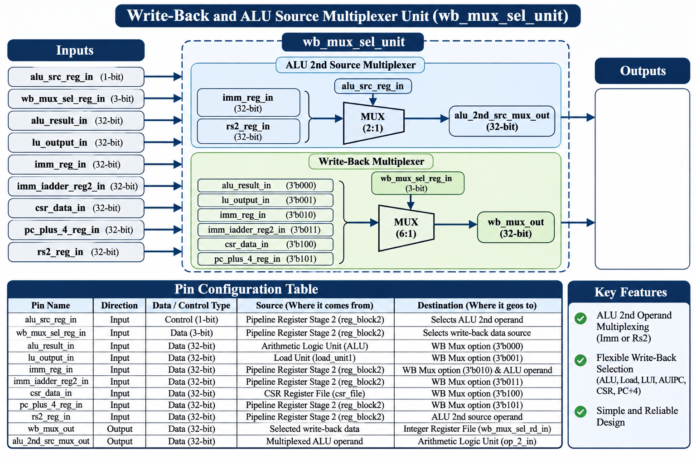

**Microarchitectural Details**

- **ALU 2nd Operand Mux**: controlled by `alu_src_reg_in`, choosing between register source `rs2_reg_in` (`1`, R-type/branch) and sign-extended `imm_reg_in` (`0`, I-type/memory).
- **Write-Back Mux**: controlled by 3-bit `wb_mux_sel_reg_in`:

| `wb_mux_sel` | Source | Used For |
|---|---|---|
| `3'b000` | `alu_result_in` | R-type and I-type ALU results |
| `3'b001` | `lu_output_in` | Loads: `LB`/`LH`/`LW`/`LBU`/`LHU` |
| `3'b010` | `imm_reg_in` | `LUI` upper immediate |
| `3'b011` | `imm_iadder_reg2_in` | `AUIPC` PC-relative sum |
| `3'b100` | `csr_data_in` | CSR readback data |
| `3'b101` | `pc_plus_4_reg_in` | Return link address for `JAL`/`JALR` |

---

### 6.13 Synthesizable On-Chip BRAM Trace & Debug Logger (`fwrite_file`)

**Primary Role:** Replaces non-synthesizable Verilog file I/O (`$fwrite`) with a hardware-synthesizable execution trace recorder for real-time Zynq-7000 FPGA debugging.


**Microarchitectural Details**

- Monitors instruction retirement events: valid register writebacks (`vrd_en`) and data memory write transactions (`reg_mem_wen != 4'b0000`).
- Packs execution telemetry into a **172-bit trace record**:

| Bits | Field | Width | Description |
|---|---|---|---|
| `[171:140]` | `reg_pc` | 32 | Current instruction Program Counter |
| `[139:132]` | `wire_rd_add` | 8 | Destination register index |
| `[131:100]` | `wrd_data11` | 32 | Register writeback payload |
| `[99:96]` | `reg_mem_wen` | 4 | Memory byte-write enable mask |
| `[95:64]` | `reg_mem_wadd` | 32 | Memory write target address |
| `[63:32]` | `reg_mem_wdata` | 32 | Aligned memory write payload |
| `[31:0]` | `reg_mem_radd` | 32 | Memory read target address |

- Auto-increments an internal 10-bit address pointer (`bram_addr_a`) to log up to **1,024 sequential execution events** into the dual-port Block RAM (`blk_mem_gen_0`).
- Routes the upper 140 bits (`douta_portA[171:32]`) to `result_status`, accommodating the physical I/O pin constraints of the ZC702 board while retaining observability.

---

### 6.14 Machine-Mode Control and Status Register File (`msrv32_csr_file`)

**Primary Role:** Implements the complete RISC-V Privileged Architecture (Machine-Mode) CSR subsystem for trap handling, interrupt management and hardware performance monitoring.

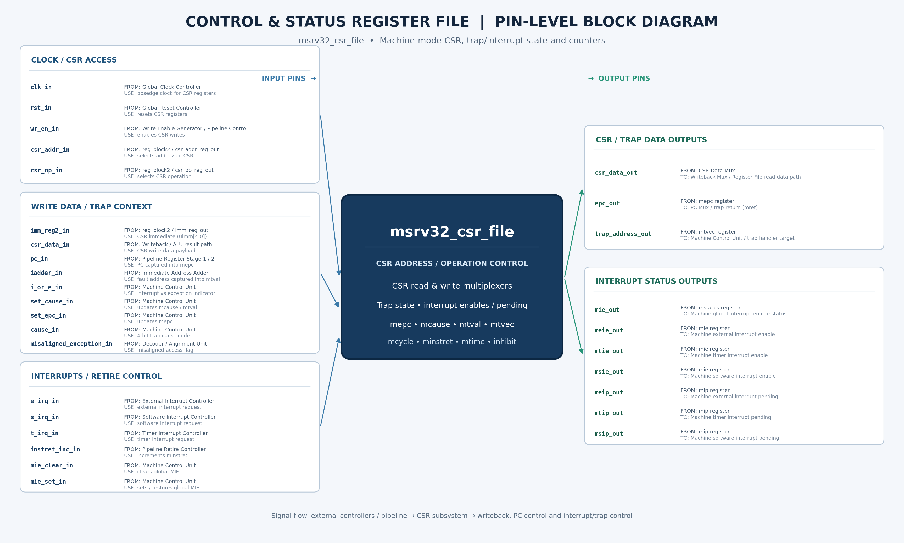

Composed of 12 tightly integrated sub-modules:

| Sub-module | Function |
|---|---|
| `csr_data_mux_unit` & `data_wr_mux_unit` | CSR address decoding for readback (`csr_data_out`) and atomic read-modify-write (`CSRRW`, `CSRRS`, `CSRRC`, `CSR_NOP`) |
| `misa_and_pre_data` | Encodes `MXL = 2'b01` (32-bit) and the base integer extension (`I` bit), and selects between register (`rs1`) and immediate (`uimm`) write operands |
| `mstatus_reg` | Global machine interrupt enable (`MIE`, bit 3) and prior interrupt enable (`MPIE`, bit 7); supports trap entry (`mie_clear_in`) and `MRET` restoration (`mie_set_in`) |
| `mie_reg` & `mip_reg` | Interrupt enable/pending flags for External (`MEIE`/`MEIP`), Timer (`MTIE`/`MTIP`) and Software (`MSIE`/`MSIP`) |
| `mtvec_reg` | Trap handler base address and mode (Direct vs. Vectored); computes `trap_address_out` (base + (cause << 2) for vectored interrupts) |
| `mepc_and_mscratch_reg` | Captures the faulting/interrupted PC into `mepc` on trap entry (`set_epc_in`) and provides a 32-bit `mscratch` |
| `mcause_reg` & `mtval_reg` | Records interrupt (`[31]=1`) vs. synchronous exception (`[31]=0`) with a 4-bit cause code; latches faulting addresses (`iadder_in`) into `mtval` for misaligned accesses |
| `machine_counter` & `machine_counter_setup` | 64-bit `mcycle`/`mcycleh`, `minstret`/`minstreth`, `mtime`/`mtimeh` counters governed by `mcountinhibit` |

---

### 6.15 Machine Control Unit

**Primary Role:** Central trap / interrupt / flush controller. It collects exception signals from the decoder (`illegal_instr_out`, `misaligned_load_out`, `misaligned_store_out`), interrupt requests and `MRET`/trap events, and drives the CSR file, `flush_in` and PC redirection.


**Input / Output Pin Configuration**

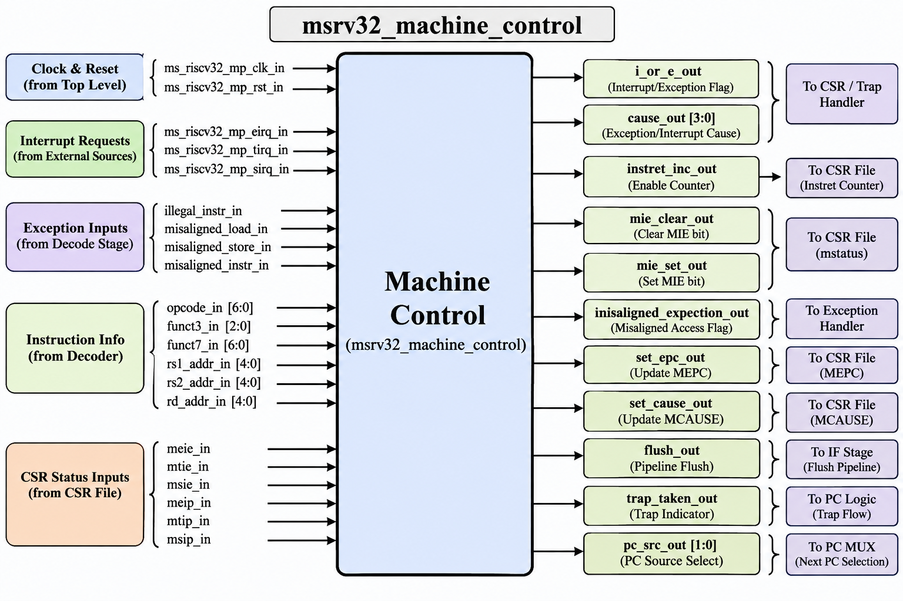

---

### 6.16 Program Counter Block

**Primary Role:** Maintains and updates the program counter, selecting between sequential `PC + 4`, branch/jump targets and trap/`MRET` vectors.

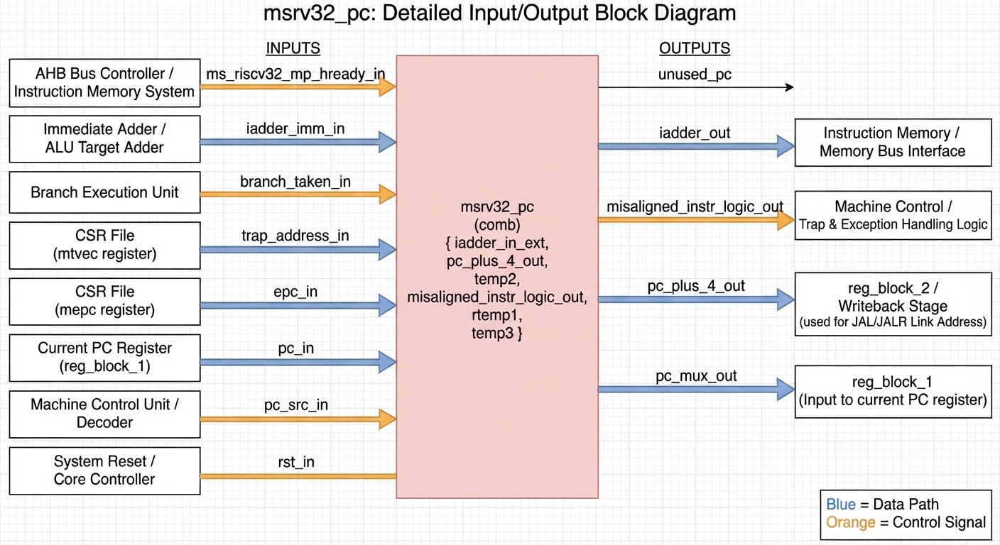

---

### 6.17 Integer Register File (`msrv32_integer_file`)

**Primary Role:** The 32 × 32-bit RV32I general purpose register file, read in Stage 1 and written back in Stage 3 (gated by the flush-protected write-enable).


---

## 7. Supported Instruction Set

### 7.1 RV32I Base Integer Instructions

| Class | Instructions |
|---|---|
| **Upper Immediate** | `LUI`, `AUIPC` |
| **Jumps** | `JAL`, `JALR` |
| **Conditional Branches** | `BEQ`, `BNE`, `BLT`, `BGE`, `BLTU`, `BGEU` |
| **Loads** | `LB`, `LH`, `LW`, `LBU`, `LHU` |
| **Stores** | `SB`, `SH`, `SW` |
| **Immediate ALU** | `ADDI`, `SLTI`, `SLTIU`, `XORI`, `ORI`, `ANDI`, `SLLI`, `SRLI`, `SRAI` |
| **Register ALU** | `ADD`, `SUB`, `SLL`, `SLT`, `SLTU`, `XOR`, `SRL`, `SRA`, `OR`, `AND` |
| **System / CSR** | `CSRRW`, `CSRRS`, `CSRRC`, `CSRRWI`, `CSRRSI`, `CSRRCI`, `MRET` |

### 7.2 Machine-Mode CSRs Implemented

| CSR | Purpose |
|---|---|
| `mstatus` | Global interrupt enable state (`MIE`, `MPIE`) |
| `misa` | ISA description (RV32I) |
| `mie` / `mip` | Interrupt enable / pending bits (External, Timer, Software) |
| `mtvec` | Trap vector base address and mode |
| `mepc` | Exception program counter |
| `mcause` | Trap cause |
| `mtval` | Trap value (e.g. faulting address) |
| `mscratch` | Scratch register for trap handlers |
| `mcycle` / `mcycleh` | 64-bit cycle counter |
| `minstret` / `minstreth` | 64-bit retired instruction counter |
| `mtime` / `mtimeh` | 64-bit real-time counter |
| `mcountinhibit` | Counter inhibit control |

### 7.3 Exceptions Detected in Hardware

| Exception | Detected By |
|---|---|
| Illegal instruction | `msrv32_decoder` (`illegal_instr_out`) |
| Misaligned load | `msrv32_decoder` (`misaligned_load_out`) |
| Misaligned store | `msrv32_decoder` (`misaligned_store_out`) |

---

## 8. Assembly Program & Execution Flow

The processor is validated using a compiled RISC-V (RV32I) machine-code workload (`Assembly_program.txt`), representing real C runtime startup, pointer dereferencing, peripheral I/O and exit cleanup routines (`__register_exitproc` and `print_uart`).

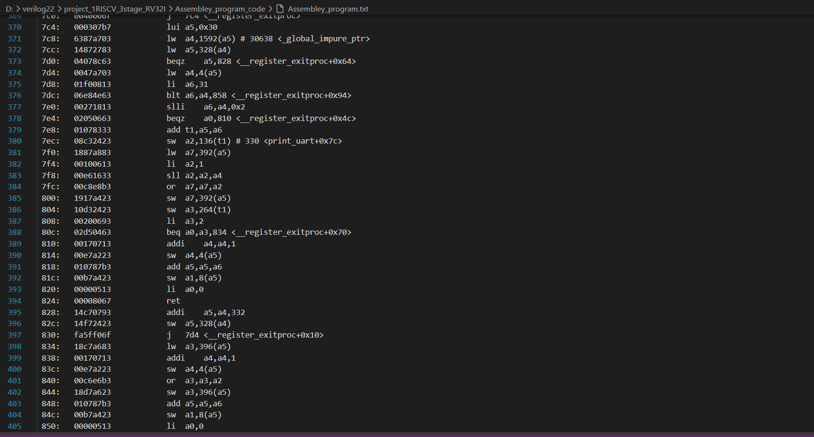

### Instruction Mix & Functional Execution Patterns

Inspecting the disassembly (`0x7c4` to `0x850`) shows comprehensive exercise of the 3-stage pipeline across every functional datapath:

| Pattern | Examples | What It Validates |
|---|---|---|
| **Upper Immediate & Pointer Base Generation** (`lui`) | `lui a5, 0x30` (`000307b7` @ PC `0x7c4`) | Loads 20-bit upper constants to establish base addresses for global data structures (`_global_impure_ptr`) |
| **Base-Plus-Offset Memory Access** (`lw`, `sw`) | `lw a4, 1592(a5)` (`6387a703` @ `0x7c8`), `lw a5, 328(a4)` (`14872783` @ `0x7cc`), `sw a2, 136(t1)` (`08c32423` @ `0x7ec`) | `imm_adder` address computation, `D_cache` synchronous read/write timing, `store_unit` byte-lane alignment |
| **ALU Arithmetic, Logical & Shift** (`addi`, `add`, `slli`, `sll`, `or`) | `li a6, 31` (`01f00813`), `slli a6, a4, 0x2` (`00271813`), `add t1, a5, a6` (`01078333`), `sll a2, a2, a4` (`00e61633`), `or a7, a7, a2` (`00c8e8b3`) | Parallel ALU paths and register-to-register writeback dependencies |
| **Control Flow** (`beqz`, `beq`, `blt`, `j`, `ret`) | `beqz a5, 828` (`04078c63` @ `0x7d0`), `blt a6, a4, 858` (`06e84e63` @ `0x7dc`), `beq a0, a3, 834` (`02d50463` @ `0x80c`), `j 7d4` (@ `0x830`), `ret` / `jalr x0, 0(ra)` (@ `0x824`) | `branch_unit` signed/unsigned comparators, `reg_block2` target alignment, `instruction_mux` flush NOP injection |

---

## 9. Simulation Results

Functional simulation waveforms captured during verification of the RISC-V core.

### Simulation Report 1
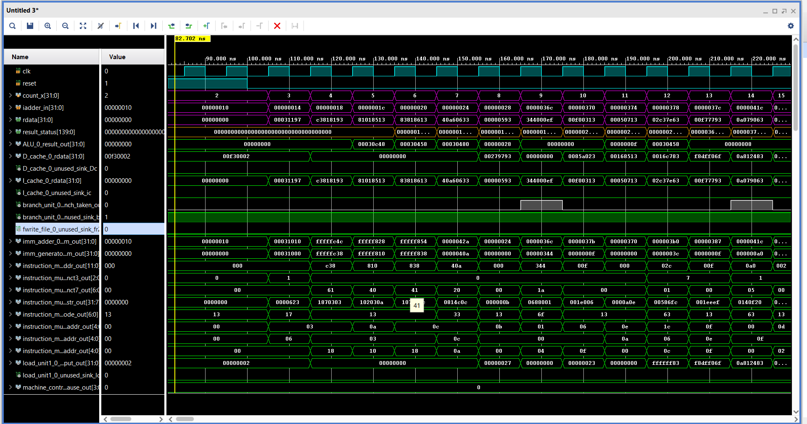

### Simulation Report 2
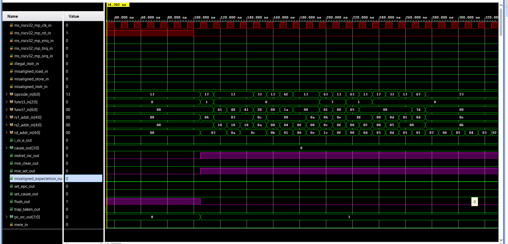

### Simulation Report 3
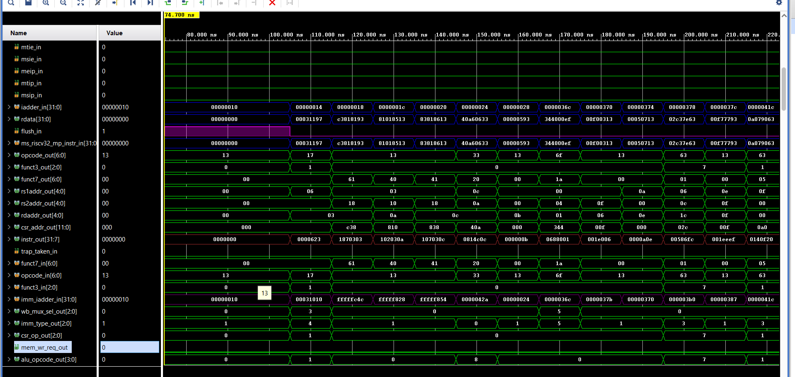

### Simulation Report 7
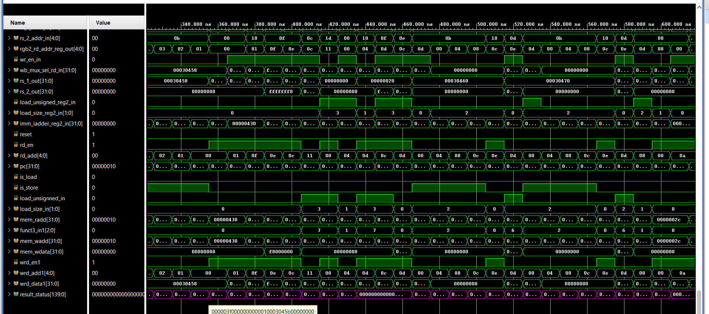

### Simulation Report 8
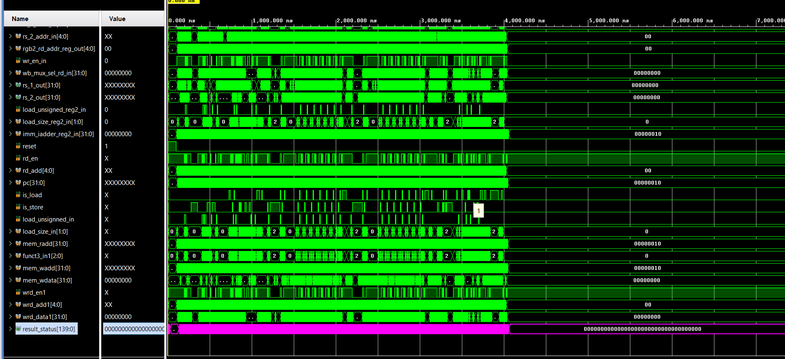

---

## 10. Hardware Execution Trace Verification

### Cycle-Accurate Execution Verification (`reg_status_sw_correct_200_boot_address.txt`)

The hardware trace logs (`Result_starus1` and `Result_starus2`) confirm bit-exact execution starting from boot address `0x00000200`. Each entry records:

- **Program Counter (PC)**, e.g. `00000200`, `0000055c`, `00000324`
- **Register updates**, tracking destination registers such as `gp`, `a0`, `t1`, `a5` and the values written
- **Data memory transactions**: read/write addresses, control masks and payloads

### Result Status 1: Internal Register & Data Memory Status


### Result Status 2: Internal Register & Data Memory Status


### Verified Behaviors

**1. Boot & Register Initialization**
At PC `0x00000200`, register `gp` (`x3`) is initialized to `0x00031200`, followed sequentially by `0x00000204` (`gp = 0x00030e38`), `0x00000208` (`a0 = 0x00030648`) and `0x0000020c` (`a2 = 0x00030670`).

**2. Sub-Word & Word Store Verification**
- Between PCs `0x000005d0` and `0x000005ec`, sequential **byte stores** (`wen = 001`) clear consecutive memory bytes from `0x0003064f` down to `0x00030648`.
- From PC `0x00000580` to `0x0000058c`, **full word stores** (`wen = 100`) write to word-aligned addresses `0x00030650`, `0x00030654`, `0x00030658` and `0x0003065c`.

**3. Character Output & Peripheral Tracing**
In the UART / memory-mapped I/O loop (`0x00000334` to `0x00000348`), the trace captures ASCII payloads `0x65 'e'`, `0x6c 'l'`, `0x6c 'l'`, `0x6f 'o'`, `0x21 '!'`, `0x0a '\n'` being loaded into `a5` from incrementing memory pointers (`0x000008dd`–`0x000008e2`) and stored (`wen = 100`) to the memory-mapped UART TX register at address `0x000001f0`.

---

## 11. Synthesis, Implementation & Resource Utilization

### A. Post-Implementation Utilization (`xc7z020clg484-1`)

Synthesized and implemented in **Xilinx Vivado 2024.2** targeting the **Zynq-7000 ZC702 Evaluation Board**, the design achieves a compact hardware footprint:

| Resource | Post-Implementation Utilization | Architectural Driver & Engineering Analysis |
|---|:---:|---|
| **Look-Up Tables (LUTs)** | **4%** | Streamlined 3-stage datapath, shared parallel ALU logic and compact control decoding minimize combinational overhead |
| **Flip-Flops (FFs)** | **2%** | A single intermediate pipeline register stage (`reg_block2`) plus machine-mode CSR state registers keep sequential element count minimal |
| **Block RAM (BRAM)** | **50%** | Dedicated on-chip storage for the instruction cache, 256 KB `D_cache`, and the 172-bit × 1024 dual-port trace logger (`blk_mem_gen_0`) |
| **Input/Output (I/O)** | **76%** | Driven by routing the 140-bit real-time execution trace bus (`result_status`) and control/clock pins directly to ZC702 package pins |
| **Global Buffers (BUFG)** | **3%** | Clean, single-clock-domain distribution across the core and synchronous BRAM primitives |

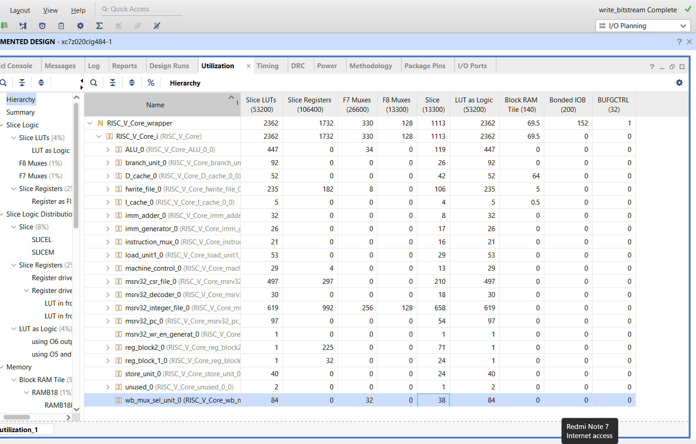

### B. Synthesis & DRC Hygiene

Synthesis (`synth_1`) completed cleanly. Explicit bit-sink tie-offs (`unused_sink_br`, `unused_st`, `unused_sink_lo`, `unused_sink_Dc`, `unused_sink_fr`) eliminated unconnected-port warnings, resulting in **0 errors and 0 warnings during implementation (`impl_1`)**.

### C. Project Summary


---

## 12. Timing Closure & Performance Analysis

Static Timing Analysis (STA) across all **4,543 timing endpoints** confirms full timing closure with **zero setup, hold or pulse-width violations**:

| Metric | Value |
|---|:---:|
| **Worst Negative Slack (WNS)** | **+0.458 ns** |
| **Total Negative Slack (TNS)** | **0.000 ns** |
| **Failing Endpoints** | **0** |

### Engineering Interpretation

- **Critical Path Validation**: A positive setup slack of +0.458 ns validates that the combinational depth, spanning Stage 2 effective address calculation (`imm_adder`), ALU parallel execution and Stage 3 BRAM/writeback multiplexing (`wb_mux_sel_unit`), fits comfortably within the target clock period.
- **Zero Hold Violations**: Synchronous clocking across `reg_block2`, `D_cache` and `msrv32_csr_file` ensures deterministic data capture without clock-skew-induced race conditions.

---

## 13. Power & Thermal Analysis

| Metric | Value |
|---|:---:|
| **Total On-Chip Power** | **0.263 W** |
| **Junction Temperature** | **28.0 °C** |
| **Thermal Margin** | **57.0 °C** |
| **Effective θJA** | **11.5 °C/W** |

The design maintains a cool junction temperature with a large thermal margin and requires **zero active cooling**.

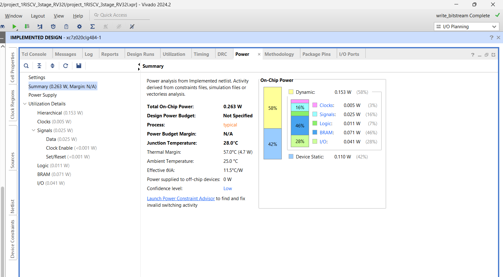

---

## 14. Placement & Routing

As verified in the device routing views, logic cells are densely packed within adjacent CLBLM and CLBLL columns (X19–X21) flanking the interconnect switch matrices (INT_L / INT_R), minimizing wire delay and preventing routing congestion. Clock distribution is clean, with `BUFG` utilization at 3%.

### Routing & Placement Schematic 1
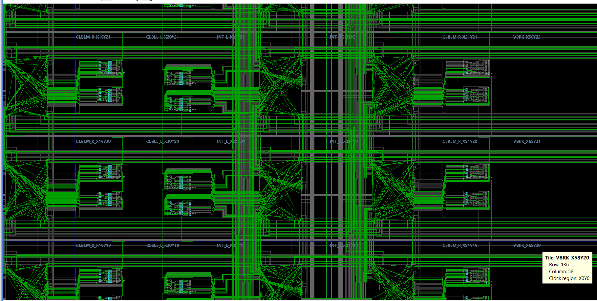

### Routing & Placement Schematic 2
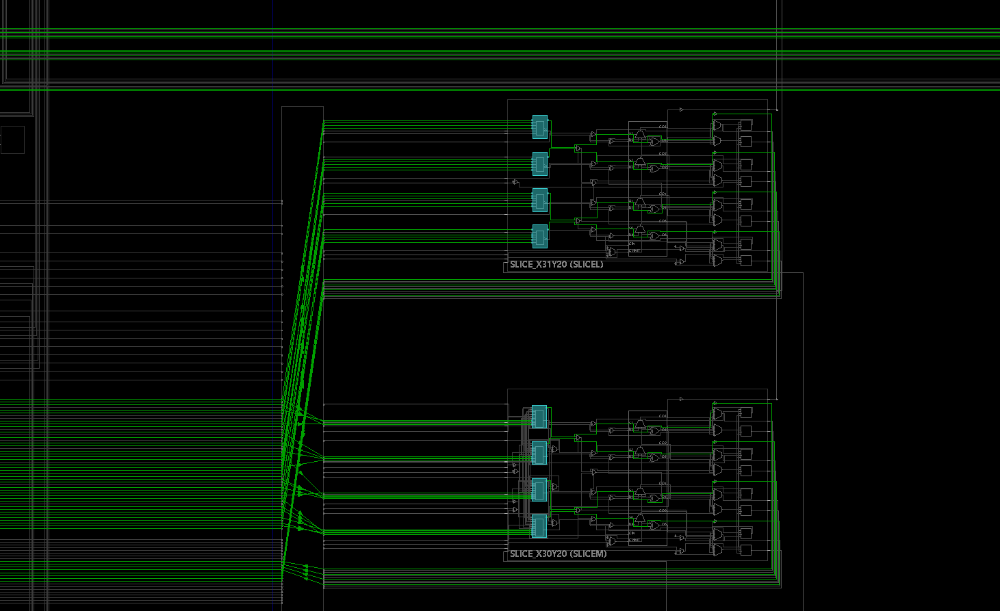

---

## 15. Bitstream Generation & Hardware Handoff (.xsa)

With post-implementation routing complete and timing fully closed, the Vivado flow generated:

- ✅ The final FPGA configuration **bitstream (`.bit`)**
- ✅ The **Xilinx Support Archive (`.xsa`)**

The `.xsa` hardware platform encapsulates the exact address map, BRAM memory initialization (`data_memory.hex`), pin constraints and clock configuration, enabling immediate **bare-metal deployment and hardware-in-the-loop verification** on the ZC702 evaluation board. This concludes the complete **A-to-Z RTL-to-FPGA design flow** for the custom RISC-V processor.

---

## 16. Repository Structure

> Adjust this tree to match your actual repository layout.

```
RISC-V-RV32I-3Stage-Pipelined-Processor-on-Zynq-ZC702/
│
├── RISC_V_PL_image/              # All block diagrams, reports and result screenshots
│   ├── Block_diagram1_of_RISC_V_Core_wrapper.png
│   ├── Stage_wise_Block_diagram_RISC_V.png
│   ├── Power_Report.png
│   ├── Simmuletion_report*.png
│   └── ...
│
├── rtl/ (or src/)                # Verilog / SystemVerilog source files
│   ├── instruction_mux.v
│   ├── msrv32_decoder.v
│   ├── imm_generator.v
│   ├── imm_adder.v
│   ├── branch_unit.v
│   ├── ALU.v
│   ├── store_unit.v
│   ├── reg_block1.v / reg_block2.v
│   ├── load_unit1.v
│   ├── D_cache.v
│   ├── wb_mux_sel_unit.v
│   ├── msrv32_wr_en_generator.v
│   ├── fwrite_file.v
│   └── msrv32_csr_file.v
│
├── tb/                           # Testbenches
├── data_memory.hex               # Data memory initialization file
├── Assembly_program.txt          # Compiled RV32I workload disassembly
├── reg_status_sw_correct_200_boot_address.txt   # Hardware trace log
└── README.md
```

---

## 17. Getting Started

### 17.1 Prerequisites

| Requirement | Details |
|---|---|
| **EDA Tool** | Xilinx Vivado 2024.2 |
| **Board** | Xilinx Zynq-7000 ZC702 Evaluation Board (`xc7z020clg484-1`) |
| **Optional** | Xilinx Vitis / SDK for bare-metal software using the exported `.xsa` |
| **Optional** | RISC-V GNU toolchain (`riscv32-unknown-elf-gcc`) to build custom programs |

### 17.2 Clone the Repository

```bash
git clone https://github.com/vijay-2020-vijay/RISC-V-RV32I-3Stage-Pipelined-Processor-on-Zynq-ZC702.git
cd RISC-V-RV32I-3Stage-Pipelined-Processor-on-Zynq-ZC702
```

### 17.3 Simulation

1. Open Vivado 2024.2 and create a new RTL project targeting `xc7z020clg484-1`.
2. Add all RTL source files and the testbench.
3. Add `data_memory.hex` (used by `$readmemh` in `D_cache`) to the project so that it is found at simulation time.
4. Set the testbench as the simulation top and run **Run Simulation → Run Behavioral Simulation**.
5. Inspect the waveforms and compare against the reference results in [Section 9](#9-simulation-results).

### 17.4 Synthesis & Implementation

1. Add the constraints file (XDC) containing the ZC702 pin assignments, including the 140-bit `result_status` bus and clock/reset pins.
2. Ensure the Block Memory Generator IP `blk_mem_gen_0` (172-bit width × 1024 depth, true dual-port) is generated.
3. Run **Synthesis → Implementation → Generate Bitstream**.
4. Confirm timing closure (WNS ≥ 0, TNS = 0) and review utilization and power reports.

### 17.5 Hardware Deployment

1. Export the hardware platform: **File → Export → Export Hardware (include bitstream)** to produce the `.xsa`.
2. Connect the ZC702 board via JTAG and program the bitstream through **Hardware Manager**.
3. Observe the `result_status` bus (e.g. through an ILA or physical pins) to monitor the cycle-accurate execution trace.

### 17.6 Running Your Own Program

1. Write your program in C or RV32I assembly.
2. Compile with the RISC-V GNU toolchain targeting `-march=rv32i -mabi=ilp32`.
3. Convert the output to a `.hex` file and use it as the memory initialization file.
4. Re-run simulation / synthesis and compare the trace against the expected execution.

> **Boot Address:** The reference trace starts execution at `0x00000200`.

---

## 18. Complete Image Gallery

A quick-reference index of all diagrams and reports included in the repository.

### 🧩 Architecture & Block Diagrams

| Image | Preview |
|---|---|
| Stage-Wise Block Diagram |  |
| Core Wrapper Block Diagram 1 |  |
| Core Wrapper Block Diagram 2 |  |
| Implementation Block Diagram |  |
| Implementation Block Diagram 2 |  |
| Implementation Block Diagram 3 |  |

### 🔧 Functional Unit Diagrams

| Unit | Preview |
|---|---|
| 32-Bit ALU |  |
| Branch & Jump Evaluation Unit |  |
| Data Cache Memory |  |
| Immediate Address Adder |  |
| Immediate Generator |  |
| Load Unit |  |
| Pipeline Register Stage 2 |  |
| Machine Control Unit |  |
| Store Unit |  |
| Write Enable Generator |  |

### 📌 Pin Configuration Diagrams

| Module | Preview |
|---|---|
| I-Cache |  |
| Instruction Mux |  |
| Register Block 1 |  |
| Machine Control (I/O) |  |
| msrv32 Decoder |  |
| msrv32 Integer File |  |
| Fwrite File Unit |  |
| CSR File |  |
| PC Block |  |
| WB Mux Select Out |  |

### 📊 Reports & Results

| Report | Preview |
|---|---|
| Project Summary |  |
| Utilization Report |  |
| Power Report |  |
| Routing & Placement 1 |  |
| Routing & Placement 2 |  |
| Assembly Program |  |
| Result Status 1 |  |
| Result Status 2 |  |
| Simulation Report 1 |  |
| Simulation Report 2 |  |
| Simulation Report 3 |  |
| Simulation Report 7 |  |
| Simulation Report 8 |  |

---

## 19. Future Work

- Add data forwarding / hazard detection for back-to-back dependent instructions.
- Extend to the **RV32IM** ISA (hardware multiply/divide) and **C** (compressed) extension.
- Add a simple **branch predictor** to reduce flush penalties.
- Integrate the core with the Zynq **Processing System (PS)** over AXI for PL + PS SoC-level co-design.
- Add a UART / GPIO / timer peripheral subsystem on the AHB/AXI bus.
- Build a **UVM-based verification environment** with constrained-random instruction streams and a reference-model scoreboard.
- Run **RISC-V compliance (riscv-arch-test)** suites for formal ISA conformance.
- Add an **ILA-based** on-board debug flow for live trace capture.
- Explore higher clock frequencies via further pipeline balancing.

---

## 20. Author & Contact

<div align="center">

### **Rabisankar Maity**
*He/Him*

**RTL Design Engineer | M.Tech VLSI @ IIT Guwahati '26 (GATE AIR 318)**

Verilog • SystemVerilog • FPGA • SoC PL+PS Integration
Creator of Full VGG-16 Hardware Accelerator & RISC-V Core | UVM Verification & IP Integration

[](https://www.linkedin.com/in/rabisankar-maity-98572b1b7)
[](https://github.com/vijay-2020-vijay?tab=repositories)
[](mailto:rabisankarmaity8250@gmail.com)

</div>

---

## 21. License

This project is released for academic and educational purposes. Add your preferred license here (for example MIT, Apache-2.0) and include a `LICENSE` file in the repository root.

---

<div align="center">

⭐ **If you found this project useful, please consider starring the repository!** ⭐

*Designed, implemented and verified from RTL to bitstream on Zynq-7000 ZC702.*

</div>
